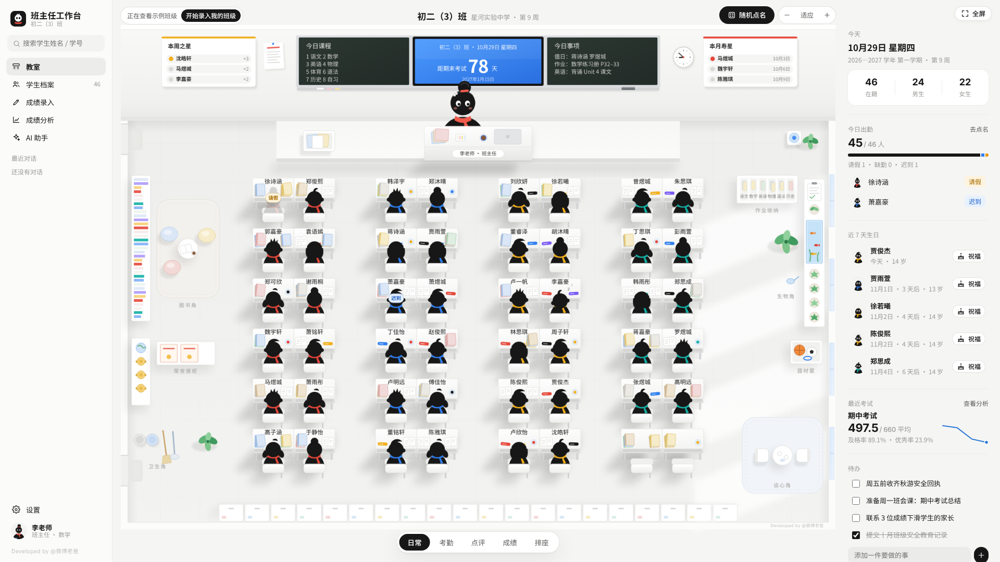
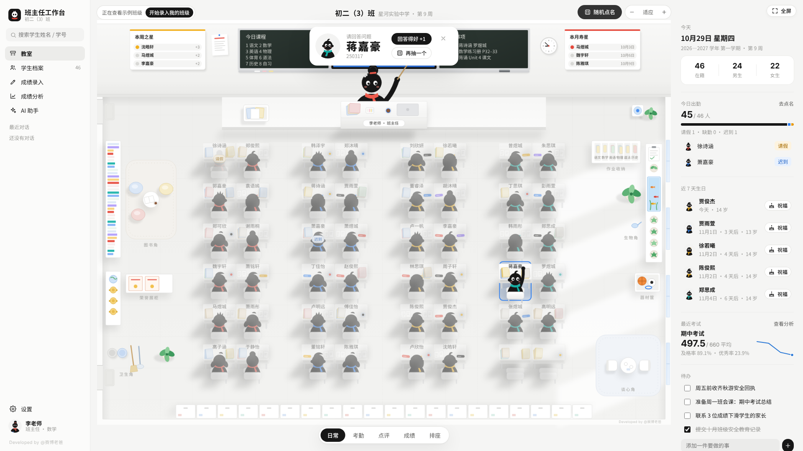
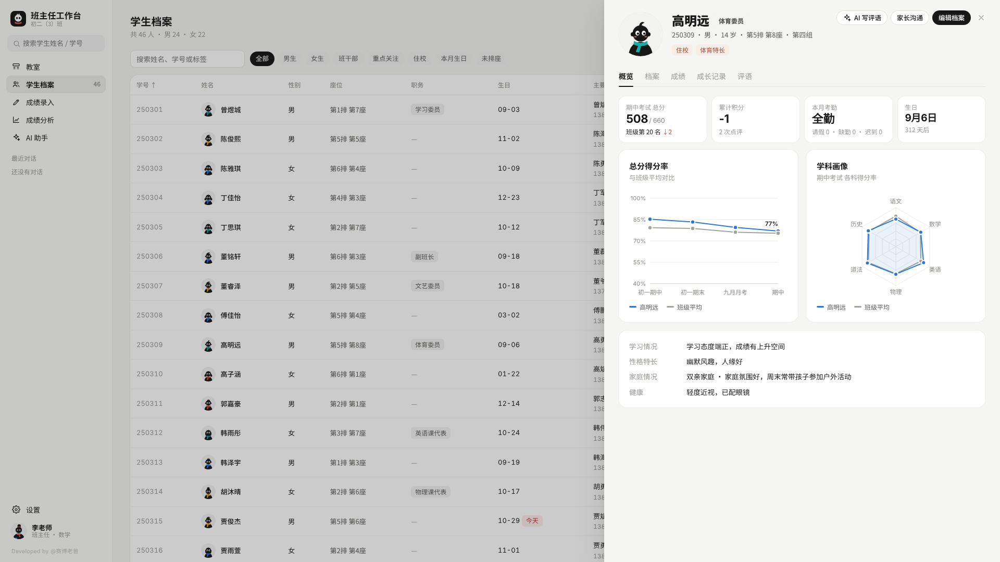
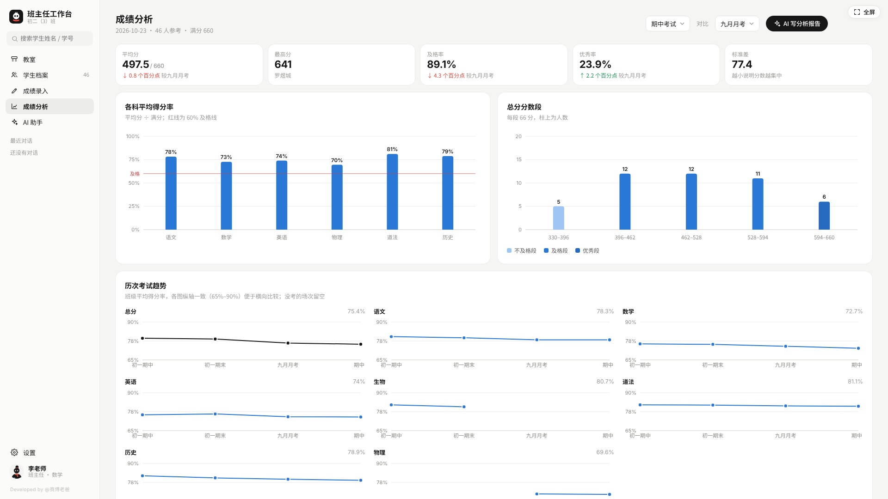
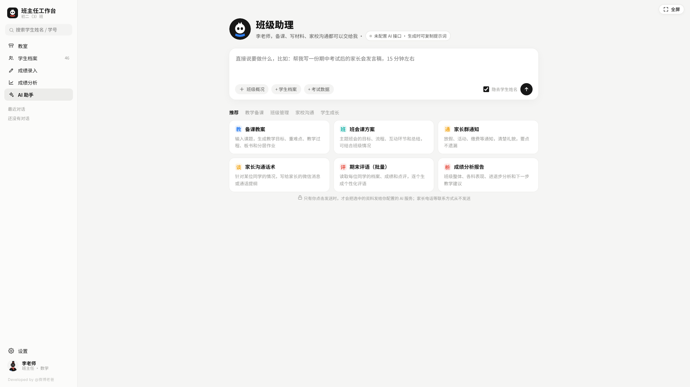

# 班主任工作台 · 使用说明

> 个人工作台系列 · 第 1 期
> 一个文件，双击就能打开的班主任工作台。

---

## 一、为什么做这个工具

班主任的工作又多又碎：每天早上要考勤，课上要点评，隔几周要排一次座位，考完试要录成绩、做分析、准备家长会，学期末还要给全班每个人写评语。还有一件件家校沟通、班会课、活动方案和工作总结。

这些事通常分散在好几个地方：成绩在 Excel 里，点名靠花名册，学生情况记在本子上或者只记在脑子里，通知和沟通都在微信里。每次要用的时候，都得到处翻。

我们想做一个班主任**自己的工作台**，把这些事放进同一个地方：

- **打开就能用**：不用注册，不用安装，学校电脑装了还原卡、不让装软件也能用。
- **数据留在自己电脑上**：学生信息属于隐私，所有数据只存在你自己的电脑上，不上传到任何地方。
- **好看，也好用**：整个工作台就是一间教室，讲台上站着你，下面坐着全班同学，谁请假、谁进步了、谁今天过生日，一眼就能看到。

## 二、适合在什么时候用

| 场景 | 用什么功能 |
|---|---|
| 新学期接新班 | 从 Excel 批量导入名单，给每个学生建档（家庭情况、联系人、学习情况、健康情况） |
| 每天早读点名 | 「考勤」模式：点一下学生就能标请假、缺勤或迟到 |
| 课堂上提问、表扬 | 「随机点名」「点评」模式，可以全屏投到教室的一体机或大屏上用 |
| 调座位 | 「排座」模式：拖动换座，或一键随机、优带弱、男女同桌，然后打印座位表 |
| 考完试 | 录入成绩（可以从 Excel 整块粘贴），看班级分析，找出进步和需要关注的同学 |
| 准备家长会、和家长沟通 | 学生档案和成绩趋势；AI 助手帮你起草发言稿和沟通内容 |
| 学期末 | 批量起草期末评语，写班主任工作总结 |
| 日常琐事 | 待办清单、近 7 天生日提醒、班级动态 |

推荐在电脑上用 Chrome 或 Edge 浏览器打开，窗口宽度 1280 以上效果最好。教室里装 Windows 系统的一体机，也可以直接用浏览器打开。

---

## 三、开始使用

1. 下载 `index.html`，用 Chrome 或 Edge 浏览器打开（双击文件，或者把它拖进浏览器窗口）。
2. 第一次打开时，选一个老师形象（女老师或男老师），填上你的称呼和任教学科。
3. 选择开始方式：
   - **先看看示例班级**：载入一个 46 人的虚构班级和 4 次考试，可以随便点、随便试。看完点左上角的「开始录入我的班级」，示例数据就会清空。
   - **直接用我的班级**：从空教室开始，填上班级名称和学段即可。
4. 点「开启工作台」，就进入教室了。

> **重要**：数据保存在你当前使用的这个浏览器里。换电脑、换浏览器、清理浏览器数据之前，请先到「设置 → 数据与备份」点「导出备份」，到新电脑上再用「从备份恢复」导入。建议每周备份一次。

---

## 四、功能怎么用

### 1. 教室

教室是主界面。前墙上有黑板和智慧屏：左边黑板写今日课程，右边写今日事项，中间显示考试倒计时，挂钟显示当前时间。宽屏下，两侧还会挂出「本周之星」（本周积分前三）和「本月寿星」。

**鼠标移到学生身上**，TA 会回头看你，同时弹出信息卡，上面有简介、家庭情况、标签、最近排名、积分和生日。点「查看档案」可以打开完整档案。**点空座位**可以直接添加学生。

教室底部有 5 个模式可以切换：

| 模式 | 怎么用 |
|---|---|
| 日常 | 平时浏览，点学生打开档案 |
| 考勤 | 点学生，状态会依次切换：出勤 → 请假 → 缺勤 → 迟到 → 出勤。请假和缺勤的同学会变成半透明。可以选日期补录，「全部出勤」一键恢复，「导出本月」导出考勤表 |
| 点评 | 点学生，选一个加分或扣分理由（比如积极发言 +1、作业未交 -1），学生头顶会飘出分数。还有「全班 +1」和「积分榜」，积分榜里能看到小组积分 |
| 成绩 | 选一次考试，桌面颜色越深，班级排名越靠前；进步或退步 5 名以上的同学会标出 ↑ 或 ↓ |
| 排座 | 拖动学生换座位，也可以先点一个座位、再点另一个座位互换。「随机打乱」「优带弱同桌」「男女同桌」一键排好，排错了点「撤销」。最后可以「打印座位表」 |

**随机点名**：点右上角「随机点名」，光标会在全班同学之间跳动，停下来的那位同学会举手，老师会拿教鞭指向 TA。请假的同学不会被抽到，刚抽过的同学会先跳过。回答得好可以直接点「回答得好 +1」。

**缩放和全屏**：右上角的「−」「＋」用来缩放教室，「适应」恢复默认大小；按住 Ctrl 再滚动鼠标滚轮也可以缩放，按住鼠标拖动可以移动教室。窗口最右上角的「全屏」会让整个工作台铺满屏幕，适合投屏，按 Esc 退出。

**右侧概况栏**：今日出勤、男女人数、近 7 天过生日的同学、最近一次考试的平均分和及格率、待办清单和班级动态。窗口较窄时它会收起来，点右上角的侧栏按钮就能打开。

### 2. 学生档案

- **名单**：可以按姓名、学号或标签搜索，也可以筛选男生、女生、班干部、重点关注、住校、本月生日、未排座；点表头可以排序。
- **添加学生**：点「添加学生」，或者在教室里点空座位。能填写的内容有：
  - 姓名、性别、学号、生日、职务、座位、标签
  - 家庭结构、两位联系人（姓名、关系、电话、职业）、家庭备注
  - 学习情况、性格特长、健康情况、其他备注
- **批量导入**：在 Excel 里选中名单（第一行要是表头）复制，粘贴进导入框；也可以选择 CSV 文件。能识别的表头有姓名、性别、学号、生日、职务、家长姓名、关系、家长电话、家庭结构、备注等，只有「姓名」是必填的。不知道格式的话，可以先点「下载模板」。
- **学生档案页**：点任意一个学生就能打开，里面有 5 个标签页：
  - **概览**：最近总分和排名变化、累计积分、本月考勤、生日倒计时、总分得分率曲线（和班级平均对比）、学科画像
  - **档案**：全部信息，联系电话可以一键复制
  - **成绩**：历次考试各科分数（不及格的标红）、排名变化曲线
  - **成长记录**：记录表扬、谈话、家访、获奖等，还能查看和撤销每一次点评
  - **评语**：自己写或者用 AI 起草的评语都保存在这里
- **导出名单**：导出 CSV 文件，可以用 Excel 打开。

### 3. 成绩录入

1. 点「新建考试」，填写考试名称、日期和类型（月考、期中、期末、周测等），再选科目、设好满分。
2. 在表格里直接输入分数。按回车跳到下一位同学，方向键可以在格子之间移动。
3. **从 Excel 粘贴**：在 Excel 里按学号顺序选中一整块分数复制，点一下表格里的起始格子，按 Ctrl + V，一次全部填好。
4. 缺考的填「缺」。超过满分的会标红提醒，不及格的分数显示为红字。总分和排名会自动算好。
5. 「按表头导入」：如果你的 Excel 成绩表带「姓名 / 学号 + 科目名」表头，可以整张表粘贴进来，列的顺序不限。
6. 「导出」可以把这次考试的成绩导出成 CSV 文件。

### 4. 成绩分析

在页面右上角选一次考试，再选一次用来对比的考试：

- **总体情况**：平均分、最高分、及格率、优秀率、标准差，以及和上次考试相比的变化
- **各科平均得分率**：图上有 60% 及格线
- **总分分数段**：每个分数段有多少人
- **历次考试趋势**：总分和每一科各一张小图
- **班级排名**：每个人的各科成绩、总分和名次进退
- **需要关注的同学**：进步之星、退步 5 名以上、两科及以上不及格

及格线是满分的 60%，优秀线是满分的 85%。

### 5. AI 助手（可选）

AI 助手帮你起草各种材料，结果都可以复制、导出成 Word、继续修改。

| 分类 | 能写什么 |
|---|---|
| 教学备课 | 备课教案、课件大纲、分层作业 |
| 班级管理 | 班会课方案、活动策划、工作总结或计划 |
| 家校沟通 | 家长群通知、家长沟通话术（针对某一位学生）、家长会发言稿（会自动带上考试数据） |
| 学生成长 | 期末评语（可以批量写全班）、成绩分析报告、谈心谈话提纲、生日祝福 |

**两种用法：**

- **不做任何设置**：点「生成」后，工作台会给你一段已经写好的提示词。复制下来，粘贴到豆包、DeepSeek、Kimi、通义等任意一个 AI 的网页版或 App 里，就能拿到结果。
- **填一个 API Key**：到「设置 → AI 接口」选服务商（DeepSeek、通义千问、Kimi、智谱、豆包、硅基流动等都可以），填上在服务商网站申请的 API Key，点「测试连接」。连接成功后，就可以直接在工作台里生成，批量评语写完还能一键保存到每个学生的档案里。

**隐私保护**：「隐去学生姓名」默认是打开的。发送之前，学生姓名会先换成【学生07】这样的编号，结果回来后再在你的电脑上换回真名。家长姓名和电话从来不会发送。AI 写出的内容只是草稿，请你看过、改过之后再使用。

### 6. 设置

| 分类 | 可以改什么 |
|---|---|
| 班级信息 | 班级名称、学校、学段、年级、学期、开学日期（用来算「第几周」） |
| 教师形象 | 女老师或男老师、称呼、任教学科 |
| 教室与黑板 | 排数和组数、教室小动画开关、黑板上的今日课程和今日事项、倒计时名称和日期 |
| 学科与点评 | 默认科目和满分，点评时可选的加分、扣分理由和分值 |
| AI 接口 | 服务商、API Key、模型名称、隐私开关 |
| 数据与备份 | 导出备份、从备份恢复、载入示例班级、清空全部数据 |

---

## 五、数据与隐私

- 学生、成绩、考勤、点评、对话这些数据，全部只保存在你电脑的浏览器里，不会上传到任何服务器。
- 只有当你在 AI 助手里点「生成」或「发送」，并且已经配置了 API 时，才会把你选中的资料发给你自己选的 AI 服务商。
- 示例班级里的姓名、电话、家庭情况，全部都是随机生成的虚构内容。
- 换电脑、清理浏览器之前，一定要先导出备份。

## 六、常见问题

**换了一台电脑，数据怎么没了？**
数据是保存在浏览器里的，每台电脑、每个浏览器各自独立。在原来的电脑上导出备份，再到新电脑上「从备份恢复」就行。

**办公室电脑和教室一体机能同步吗？**
目前不能自动同步。可以在一台电脑上导出备份，再到另一台上恢复。

**AI 提示「连不上」怎么办？**
先检查 API Key 和接口地址有没有填对，账户里有没有余额。有些服务商不允许网页直接连接，可以换一家试试，或者使用文件夹里的 `ai-proxy.js`：电脑装好 Node.js 之后，在文件夹里运行 `node ai-proxy.js`，再把接口地址改成 `http://127.0.0.1:8787/` 加上原来的地址，比如 `http://127.0.0.1:8787/https://api.deepseek.com`。

**AI 提示「模型名不对」怎么办？**
各家服务商会更新模型名称。到服务商后台复制最新的模型名，填到「设置 → AI 接口 → 模型名称」里。

**教室显示太小，或者看不全？**
用右上角的「＋」「−」缩放，或者按住 Ctrl 滚动滚轮；按住鼠标可以拖动教室，点「适应」恢复默认大小。

**可以在手机上用吗？**
这个版本只做了电脑端，手机端会在之后的版本里推出。

---

## 七、文件说明

| 文件 | 作用 |
|---|---|
| `index.html` | 工作台本体，打开它就能用 |
| `ai-proxy.js` | 可选，AI 连不上的时候用的本机转发小工具 |
| `screenshots/` | 说明文档里用到的截图 |
| `LICENSE` | 开源协议全文 |

## 八、开源协议

本软件采用《班主任工作台非商业许可协议》，全文见 [LICENSE](LICENSE)。简单来说：

- ✅ **允许**：个人免费使用、复制、修改、二次开发，也可以分享修改后的版本
- ✅ 分享时要保留原作者署名和本协议，修改后的版本也必须继续使用本协议
- ❌ **禁止任何形式的商业使用**，包括但不限于：出售或付费下载、收费安装或部署、作为付费产品或服务的一部分、用于营利机构的经营活动、加入广告牟利、用于付费课程或付费社群
